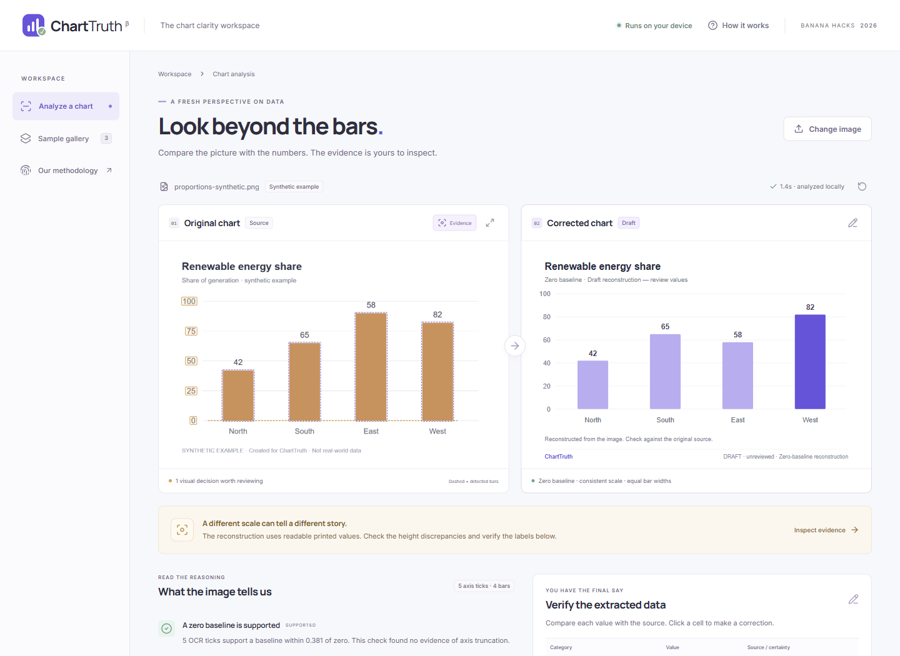

# ChartTruth

**See the whole picture.** An original chart-forensics workspace for Banana Hacks 2026.

**[Live demo](https://ailhomov.github.io/charttruth/) · [Public source](https://github.com/AIlhomov/charttruth) · [External evaluation](docs/evaluation/README.md)**

Upload a bar-chart screenshot, inspect the evidence, correct extracted values, and compare the source with a zero-baseline reconstruction. Processing runs in your browser, with no account, API key, paid service or external inference endpoint.



Actual browser capture, using synthetic example data. See the [empty workspace](docs/screenshots/workspace.png) and [mobile workflow](docs/screenshots/mobile.png).

## Run locally

Requires **Node.js 22.12+** (Node 24 recommended) and npm. Chrome/Edge are the tested browser family. Other modern browsers may work but have not been validated.

```sh
npm ci
npm run dev
```

Open the local URL printed by Vite, normally `http://127.0.0.1:5188`.

`npm ci` runs `scripts/prepare-ocr.mjs`, copying the OCR worker, WebAssembly variants and the English model into `public/ocr/`, then generates the distributed license bundle. Internet access is required to install packages; image analysis itself makes only same-origin asset requests. If installation scripts were disabled, run `npm run postinstall` before starting or building.

```sh
npm run build
npm run preview
```

The static `dist/` directory contains everything required at runtime, including OCR assets. Serve it over HTTP(S); opening `index.html` with `file://` does not support workers. There is no backend to configure. Sessions are intentionally temporary: reload clears the uploaded image and edits. Tesseract may cache its public English model in browser IndexedDB; uploaded charts are not persisted by ChartTruth.

## Use it

1. Upload, drag/drop or paste a PNG/JPEG/WebP, or choose one of three **synthetic** examples.
2. Compare the source and reconstruction. Toggle detected bars and tick evidence, or enlarge the source.
3. Inspect the findings and diagnostics. An OCR score is an engine diagnostic, not a probability; height-derived values show an error estimate.
4. Correct labels and values. Add a title, unit or context note as needed. Findings describe the original image and do not change when edited values change.
5. Confirm your review, then export a 2000 × 1260 PNG, accessible SVG or JSON evidence report. Editing again resets review. User review does not mean independent verification.

## Actual automatic scope

- 2–16 solid, flat, separated **vertical bars**, one series, nonnegative values, light background and readable English text.
- A linear y-axis with at least **three** readable numeric ticks reaching close to the baseline; supported numeric forms include percentages, currency symbols, decimals and K/M/B suffixes.
- Clearly identifiable bars of similar width and a common lower edge. Thin outlines, textures, gradients and axes connected to dark fills can be rejected.
- Raster images under 10 MB, 100 × 100 pixels or larger, at most 20 megapixels. Images are normalized to a maximum 1500-pixel edge for analysis.

Line, pie, horizontal, stacked, grouped, 3D, log-scale, negative-value and ambiguous charts are outside scope. Structural checks reject the tested unsupported examples, but this is a heuristic detector, **not a universal chart-type classifier**. Some unusual charts can resemble supported geometry. Always inspect the source, evidence and table. When evidence is insufficient, the app explains why and offers explicitly labeled manual reconstruction; it does not invent an extraction or issue a scale verdict.

ChartTruth checks visible presentation. It cannot detect cherry-picked context, validate the data source or determine the author's intent. Starting quantitative bars at zero is a useful default, not a universal claim about all charts. Specialist context can be recorded in the export; the reconstruction itself retains zero.

## Real pipeline

Canvas pixels → original connected-component geometry worker → Tesseract.js OCR → targeted tick/label crops → linear axis calibration → label/height cross-check → editable SVG reconstruction.

No sample ID, fixture values, LLM output or cached analysis is passed to the analyzer. The sample generator creates pixels; the same analyzer processes samples and uploads. OpenCV is not required: the original TypeScript implementation provides equivalent classical image-processing operations for this narrow rectangle-detection task.

See [Architecture](docs/ARCHITECTURE.md) for algorithms, thresholds, confidence semantics and failure modes.

## Gauntlet

```sh
npm test
npm run build
npm run test:e2e
# Or run the entire implement-test-inspect-fix gate:
npm run gauntlet
```

The Playwright suite uses installed Google Chrome locally and bundled Chromium in CI. For a machine without Chrome, install it or remove the `channel` setting in `playwright.config.ts` and run `npx playwright install chromium`. Run `npm ci` with development dependencies to get test tooling. Tests launch an isolated server on port 5191 and fail if it is occupied. To test an already served production build, set `CHARTTRUTH_TEST_URL` to its complete application URL, including any subdirectory and a trailing slash.

Tests execute real browser OCR, rather than mocking extracted results. Coverage includes all three samples, independent JPEG and percentage fixtures, unsupported geometries/scales, upload/drop/paste, cancellation/restart, manual corrections, review invalidation, export bytes, responsive widths and automated accessibility checks. Artifacts go to `output/playwright/`; failed checks retain traces in `test-results/`.

See [Verification](docs/VERIFICATION.md) for the measured boundary.

The follow-up external stress test tried **20 real Misviz charts: 1 numerical reconstruction and 19 rejections**. The reconstructed chart's category labels still required manual correction. Most cases fall outside the narrow automatic family. These exploratory results informed fixes and do not establish general accuracy; see the [complete protocol, sources and outcomes](docs/evaluation/README.md).

## Project documentation

- [Technical architecture](docs/ARCHITECTURE.md).
- [Verification](docs/VERIFICATION.md) and [external evaluation](docs/evaluation/README.md).
- [AI disclosure](docs/AI_DISCLOSURE.md).
- [Dependency/model attributions](THIRD_PARTY_NOTICES.md).

All original application code, tests, documentation and synthetic charts were created on **10 October 2026**, during the published hacking period. Existing research repositories in the parent workspace are references and are **not part of this repository**. No competitor application code or reference artwork is included.

## License

Original ChartTruth code: [MIT](LICENSE). Third-party dependencies and OCR model files retain their own licenses. See [notices](THIRD_PARTY_NOTICES.md).
