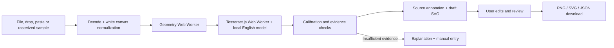

# Technical architecture

## Data flow and boundaries

There is no inference API, image-upload endpoint, account or server database. Vite only serves static application, font and OCR assets. The production build uses relative paths for subdirectory hosting. Workers and model assets must be served over HTTP(S).

## Files and responsibilities

| Location                          | Responsibility                                                                   |
| --------------------------------- | -------------------------------------------------------------------------------- |
| `src/analysis/types.ts`           | Typed OCR, geometry, calibration, datum, finding and progress contracts          |
| `src/analysis/geometry.ts`        | Pure pixel segmentation and rectangle measurement                                |
| `src/analysis/geometry.worker.ts` | Worker boundary and transferable pixel buffer                                    |
| `src/analysis/pipeline.ts`        | Input guards, normalization, OCR lifecycle and crop refinement                   |
| `src/analysis/calibration.ts`     | Numeric parsing, axis fit, extraction, evidence and edit validation              |
| `src/charts/render.ts`            | Safe SVG generation, zero-domain scaling, PNG rasterization and downloads        |
| `src/components/`                 | Logo, source annotation, findings, gallery and explanatory dialog                |
| `src/App.tsx`                     | Workspace lifecycle, edits, review gate and actions                              |
| `src/samples.ts`                  | Three synthetic image specifications and pixel generation; no analysis shortcuts |
| `tests/analysis.test.ts`          | Pure algorithm and transformation tests                                          |
| `tests/e2e/`                      | Real OCR workflows and independent adversarial fixtures                          |
| `scripts/prepare-ocr.mjs`         | Same-origin asset/license preparation                                            |

## Geometry

The original detector thresholds the normalized RGBA image into a foreground mask. Coloured fills need channel spread >12 and either relative saturation >0.30 or a darker muted fill (maximum channel <205, minimum <150). Their minimum channel must be <205; dark pixels with maximum channel <155 are also included. This excludes pale tinted paper while retaining muted second series that must not silently disappear. Four-connected flood fill separates chromatic from neutral pixels, limits hue difference to 18 degrees from each component seed, and limits neutral brightness difference to 50. It measures bounds, area, average colour and rectangular fill ratio. Candidates must satisfy size constraints and fill >0.87. Smooth brightness shading can remain one component without merging into touching axis ink.

A maximum common-bottom cluster (tolerance max(3 pixels, 0.009 × image height)) establishes 2–16 bars. Widths must be within 30% of the median; overlaps, aligned stacked components and abrupt interior colour changes are rejected. Adjacent interior samples must differ by no more than 70 summed RGB units; smooth shading can pass, while tested touching stacks fail. Sampling excludes edge pixels so antialiasing on a short bar is not treated as an interior segment. The largest cluster is a **heuristic**, not a semantic guarantee. Ambiguous axis connections, outlines, tiny bars, image clutter and unusual chart designs can cause rejection or incorrect candidates.

Long neutral horizontal rows supply candidate gridline positions. A dark vertical axis spine also locates short ticks: tick ink must connect to the spine so nearby number glyphs are not mistaken for marks. The measured tick extent clips OCR crops before the axis ink. A continuous dark horizontal axis near the bar bottoms supplies its measured centre; this avoids treating an axis stroke covering the final bar pixels as a small nonzero baseline. These pixels locate crops and refine OCR anchors; **they do not supply numeric values**.

The external evaluation exposed an omitted short bar. Candidate height now starts at max(5 pixels, 0.018 × normalized image height). Confident category text below the baseline that cannot be associated with a detected bar causes rejection, reducing incomplete reconstructions when a very short or zero-height bar is missed. Tiny bars and unreadable category text can still evade these heuristics.

## OCR and structure

Tesseract.js 7 uses its LSTM engine and the distributed English `4.0.0_best_int` model. Full-image sparse-text recognition supplies words, boxes and engine certainty. Targeted single-line crops retry missing y ticks at detected gridlines, missing printed values above measured bars, and missing category labels below the shared baseline. Crops include white padding and are mapped back to the same normalized pixel coordinate system. Numeric OCR is not forced with a digit whitelist; recognized text must pass strict numeric parsing.

Axis candidates lie left of the bars, share a right edge and have engine certainty ≥45. Printed value candidates need certainty ≥70, near-center alignment, and proximity above the bar top. Category labels are associated by x position below the baseline. Excess missing labels or duplicate associations cause rejection to reduce grouped-chart false positives. Text association remains a limited spatial heuristic.

Tick crops also retry the measured baseline position, including axes without full-width gridlines. Crop height is bounded by observed tick spacing to avoid merging adjacent numbers. Small text receives 2× crop enlargement; larger numeric text retries at 2× only if the native crop yields no accepted number. The numeric acceptance threshold stays at 70. Category retries use 2× enlargement and run when any associated word has low certainty or contains only punctuation. Overlapping retries retain stronger engine-certainty readings, removing all weaker overlapping boxes when a retry joins words. When text and certainty are identical, the tighter focused box wins, preventing attached tick ink from corrupting numeric-column alignment. Coordinates are mapped back before calibration. No retry is chosen because it agrees with an expected value or bar height. Printed numbers far outside the calibrated numeric range cause a review fallback.

## Linear calibration

Using **all** accepted y ticks, least squares fits `value = slope × pixelY + intercept`. At least three ticks, negative slope, R² ≥0.995, maximum residual ≤2.5% of numeric span and ≥40 pixels of tick coverage are required. Extrapolation beyond 15% of tick pixel coverage to reach the baseline is rejected. No outlier tick is silently dropped to force a fit.

The estimated geometry error is `max(2 × |slope|, 2 × RMS residual)`. A baseline within this estimate of zero is treated as zero. If a detected tick is within two pixels of the baseline and within the error estimate, its read value anchors the displayed baseline. Otherwise the fitted estimate is retained. A positive baseline finding needs the estimate to exceed its error. Negative values are outside automatic scope.

These bounds are engineering tolerances, **not a statistical confidence interval**. They do not model every OCR, geometry or source error.

## Independent proportion check

Each bar top yields a geometry value. Where a readable printed label exists, the reconstruction uses the printed number and preserves the geometry estimate separately. A discrepancy is flagged only when it exceeds both twice the geometry error and 3% of the axis range above baseline. Missing printed values remain explicitly labeled geometric estimates; their heights cannot independently validate the values derived from those same heights.

An incorrect printed label and an incorrectly drawn bar can cause the same discrepancy. ChartTruth asks for review rather than identifying an author's intent. It never certifies data truth or detects context manipulation.

## Editing, safety and export

Values must be finite, nonnegative and ≤10¹²; at least one must be positive. Labels require 1–48 characters. Invalid data suppresses reconstruction and blocks review/export. Changing values or chart metadata invalidates prior review. SVG text is XML escaped before insertion; uploaded SVG is rejected. Evidence remains tied to the image, with original and current values retained separately in JSON.

The SVG includes a title, complete value description, zero baseline and review provenance. PNG export rasterizes this SVG at 2× resolution. JSON records raw OCR words, ticks, calibration, original data, edits and source attribution. Manual rows carry manual provenance, not fabricated OCR confidence. OCR jobs have a deadline and cancellation; request IDs prevent stale results replacing a new image. Object URLs and workers are disposed. Browser state is temporary.

## Why this architecture

Classical geometry plus OCR is inspectable and small enough for a browser. A heavyweight chart-to-table model or a vision-LLM response would increase setup, resource needs and ungrounded interpretation risk. The product's distinction is the short path from visible evidence to a reviewable correction. Reliability is scoped to the tested structural family; general chart understanding is future work.
